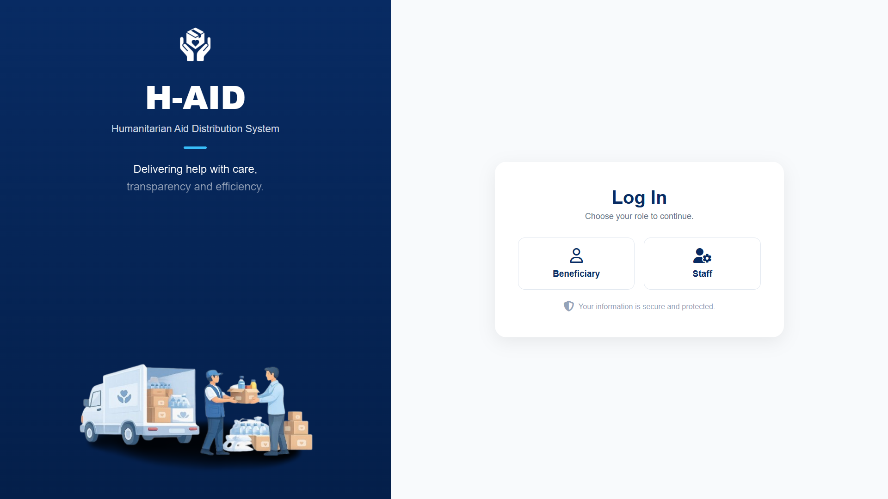
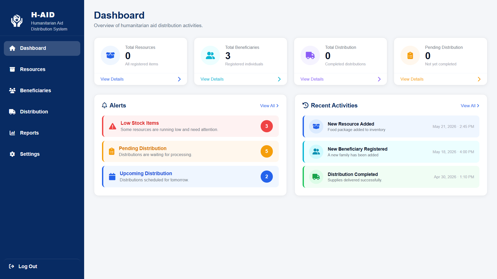

# H-AID – Humanitarian Aid Distribution Management System

## About the Project

H-AID is a Humanitarian Aid Distribution Management System developed to organize and manage the aid distribution process.

The system provides an organized interface for staff to manage resources, beneficiaries, and distribution operations efficiently.

## Key Features

- **Dashboard:** Provides an overview of the system.
- **Resources Management:** Manage available humanitarian resources.
- **Beneficiaries Management:** Manage beneficiary information.
- **Distribution Management:** Organize and manage aid distribution operations.
- **Reports:** Display distribution-related reports.
- **Settings:** Manage system settings.
- **User Roles:** Supports Staff and Beneficiary roles.

## Technologies Used

- **HTML5:** Used to structure the web pages.
- **CSS3:** Used to style the interface and create responsive layouts.
- **JavaScript (ES6+):** Used to implement interactive features and system functionality.
- **LocalStorage:** Used to store and manage data locally in the browser.
- **Font Awesome:** Used for icons and visual elements.

## User Roles

The system supports two main user roles:

- **Staff:** Responsible for managing resources, beneficiaries, and aid distribution operations.
- **Beneficiary:** Can access the system to view relevant information related to their aid.

## How to Run the Project

1. Clone the repository:

```bash
git clone https://github.com/razanhali/H-AID.git
```

2. Open the project folder:

```bash
cd H-AID
```

3. Open `index.html` in your browser or use Live Server in VS Code.

## Project Limitations

- This project is Front-End only.
- Data is stored locally using LocalStorage.
- No real database or back-end integration is implemented.
- The project uses mock data for demonstration purposes.

## Project Information

- **Project Name:** H-AID
- **Project Type:** Graduation Project
- **Field:** Humanitarian Aid Distribution Management
- **Development:** Front-End Development
- **Year:** 2026

## Screenshots

### Login Page



### Dashboard

